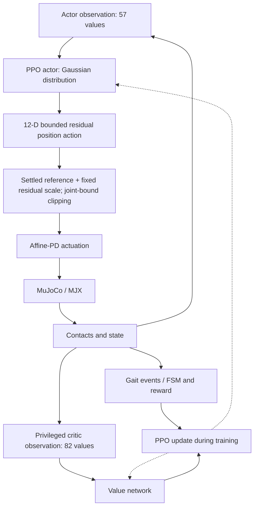
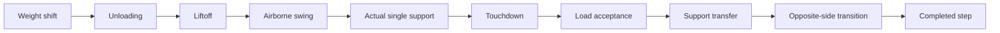
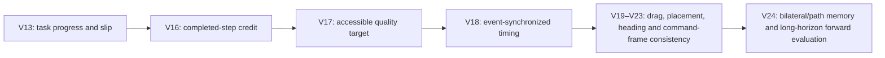
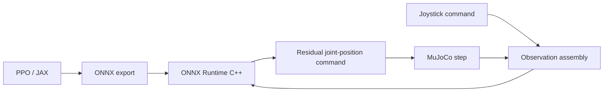

<div align="center">

# PPO-Based Forward Locomotion for a Custom Biped Robot

### Reinforcement Learning for Gait Acquisition and Locomotion Control

A reinforcement-learning study of gait acquisition, residual joint-position control,
event-based reward shaping, and quantitative forward-locomotion evaluation in MuJoCo/MJX.


[](docs/release_assembly.md)
[](LICENSE)

**Validated forward locomotion in simulation: 6.9976 m over 60 s · 0 falls**

[Methodology](docs/methodology.md) · [V24 result](docs/v24_forward_result.md) ·
[Research progression](docs/experiment_lineage.md) · [Reproducibility](docs/reproducibility.md)

</div>

> **Scope.** V24 is the canonical forward-walking result. The contribution is the RL/control
> formulation, gait acquisition process and quantitative evaluation. The restricted robot
> URDF/MJCF is intentionally excluded. Public tests validate software contracts, not the
> exact physical result. U13 is a secondary negative command-tracking finding.

<!-- Approved V24 media can be inserted here later, with checkpoint, horizon and approval context. -->

## Research question

How can PPO acquire stable forward locomotion for a custom biped that initially had no
validated forward gait? Dense velocity reward alone was insufficient: non-walking behavior
could collect reward. The study developed observations, residual position control and
physically qualified gait events together, then checked whether reward gains corresponded
to displacement, alternating support and sustained balance.

## Main result

The canonical V24 checkpoint `000003440640` traveled **6.9976 m in 60 s** with **zero falls**.
Its mean body-frame forward velocity was **0.1151 m/s**, with **34.56% single support**.
These are historical measurements from the original compatible model and checkpoint;
this modular release has not been physically revalidated. [Full evidence](#v24-canonical-results).

## Research overview

| Research component | Design question |
|---|---|
| Problem formulation | What distinguishes a completed walking step from reward-seeking motion? |
| Observation/action design | What state does the policy need, and how should it influence joint targets? |
| Asymmetric PPO | How can privileged training state support a compact actor observation? |
| Reward and FSM design | How can credit follow unloading, swing, touchdown and completed transfer? |
| Iterative experiments | Which limitation motivates the next intervention? |
| Physical evaluation | Does the resulting behavior make forward progress with valid bilateral support? |

The package retains the active V24/U13 implementation and shared machinery. Historical
experiments are documented as research evidence rather than shipped as duplicate modules.
[Methodology](docs/methodology.md) · [Implementation mapping](docs/implementation_mapping.md).

## RL/control architecture



Simulation, mappings, references, bounds and gains enter through an external authorized
model interface. They are not distributed. [Control architecture](docs/control_architecture.md).

## Control formulation

For the **active canonical V24 path**:

$$
 a_t\in[-1,1]^{12},\qquad
 q_{\mathrm{target}}=\operatorname{clip}
 \left(q_{\mathrm{settled}}+s\odot a_t,\ q_{\min},\ q_{\max}\right).
$$

The target drives affine-PD actuation; the action is **not direct torque**. The settled
reference and residual scale are fixed within an episode and supplied at runtime.
Phase conditions observations, reward gates and FSM timing. The general phase-conditioned
reference/scale helpers describe broader methodology and earlier implementation ancestry;
they are overridden in the final V24 control path, not active optional switches.
[Exact distinction](docs/control_architecture.md).

## Observation space

V24 uses **57 actor / 82 critic** values. Privileged critic-only state is kept out of the actor.

| Actor group | Contents | Why it is present |
|---|---|---|
| Proprioception | Joint-position residuals, joint velocities, up vector, body-frame linear velocity, angular velocity | Posture, balance and motion feedback |
| Gait context | Phase, previous action, foot contacts | Temporal coordination, control continuity and support awareness |
| Task context | Command, lateral path error, heading error, bilateral placement imbalance, `pair_valid` | Desired motion and persistent path/placement errors |

The critic additionally receives global state, normalized actuator effort, knee state and
placement memory. U13 uses **64 actor / 89 critic** values; its extra context includes
locomotion request, command norm, start side and transition progress. Actor indices 61–63
remain zero in U13. [Exact groups, indices and critic layouts](docs/observation_space.md).

## Action and policy distribution

The actor has **24 distribution outputs for 12 action channels**: 12 Gaussian location
parameters and 12 raw scale parameters. Scale is `softplus(raw_scale) + 0.001`.
Training samples the tanh-normal policy; deterministic evaluation uses **`tanh(location)`**.
This is not the analytic mean of the squashed distribution. Residual positions are clipped
to runtime joint bounds, then actuated through PD. [Action space](docs/action_space.md).

## PPO actor–critic architecture

```text
Actor:  57 → 256 → 256 → 128 → 24
Critic: 82 → 256 → 256 → 128 →  1
```

The asymmetric actor–critic uses SiLU hidden layers. Canonical V24 training uses 1,024
parallel environments, unroll 10, learning rate `2e-4` and PPO clip `0.30`.
The [resolved PPO settings](docs/ppo_configuration.md) include batching, discounting,
GAE and the distinct U13 profile; runnable configuration lives in [configs/](configs/).

## Reward engineering and gait acquisition

The acquisition objective follows physical progress rather than treating every contact
change as a completed step:



Debounce and event qualification distinguish brief contact changes from meaningful support
transfers. Reward shaping combines acquisition, task progress, stability and penalties.
A configured coefficient does not establish runtime accessibility: `excessive_clearance`
is unreachable on the active V24 path, and its stale coefficient is zero in this edition.
[Reward design and FSM semantics](docs/reward_design.md).

## Experiment progression



The full research sequence is V13 → V16 → V17 → V18 → V19 → V20 → V21 → V22 → V23 → V24.
V10–V12 and V14–V15 are side branches. V18's large improvement is consistent with the timing
hypothesis, but single-seed evidence and concurrent timing changes do not establish causality.
[Milestone hypotheses, interventions, metrics and next limitations](docs/experiment_lineage.md).
These milestones are not fabricated Git branches or historical commits.

## Evaluation methodology

Episode reward alone did not validate locomotion. Evaluation measures displacement,
body-frame velocity, liftoff, touchdown, single-support occupancy, completed support transfers,
same-side repetition, unexpected-side events, transfer timeout, falls and action/ctrl/force
saturation. **Mean body-frame velocity and world displacement / elapsed time are distinct
metrics.** [Evaluation definitions and evidence](docs/v24_forward_result.md).

## V24 canonical results

| Metric | Canonical value |
|---|---:|
| Checkpoint | `000003440640` |
| Evaluation horizon | 60 s |
| Forward displacement | 6.9976 m |
| Body-frame forward speed | 0.1151 m/s |
| Command speed | 0.09997 m/s |
| Single-support occupancy | 34.56% |
| Falls | 0 |
| Transfer timeouts | 0 |
| Unexpected-side events | 0 |
| Maximum same-side sequence | 1 |
| Action / ctrl / force saturation | 0 / 0 / 0 |

These establish forward locomotion in the reported simulation run, not omnidirectional
control or multi-seed robustness. [Machine-readable summary](results/v24_summary.json).

## Beyond forward walking: U13 finding

U13 reused the software/environment lineage but trained with a **fresh actor, critic,
optimizer and normalizer**, no V24 checkpoint restore and no frozen layers.

| 20 s evaluation | Deterministic | Stochastic |
|---|---:|---:|
| Single-support occupancy | 34.81% | 28.61% |
| Forward displacement | −0.032 m | +0.030 m |
| Mean body-frame forward velocity | −0.0021 m/s | +0.0012 m/s |

The deterministic mean command was +0.0486 m/s, with mean absolute velocity error
0.0574 m/s. Bilateral gait acquisition therefore did **not** establish successful
command-conditioned locomotion. Lateral, yaw, backward and general unified success are
not claimed. [Full U13 findings and reward accounting](docs/u13_findings.md).

## Actuator-effort analysis

The method uses **`qfrc_actuator` only**, sampled at **500 Hz**, to compute peak absolute,
p99 absolute and RMS generalized effort. Revolute joints use **N·m**; prismatic joints use
**N**. Public data contain anonymized aggregates, not raw trajectories, private mappings
or limits. These are simulation generalized efforts, **not motor-sizing specifications**.
[Methodology](docs/actuator_effort.md) · [Aggregate results](results/v24_effort_summary.csv).

## Repository structure

```text
src/biped_locomotion/
  model/           external model contract and validation
  control/         residual positions, references, PD
  observations/    actor and privileged critic construction
  gait/            events, phase and FSM
  rewards/         acquisition, forward and unified shaping
  commands/        command transforms and transitions
  environments/    active V24/U13 runtime assembly
  training/        PPO profiles, initialization, checkpoint contract
  evaluation/      metrics, scenarios and qualification
  analysis/        generalized effort and reward accounting
  deployment/      ONNX export and NumPy reference for the deterministic actor
configs/           resolved public profiles
results/           sanitized canonical aggregates
examples/          synthetic contract demonstration
tests/             public contract tests
tools/            config, evaluation, smoke, scan and ONNX export entry points
native/v24_runtime/ C++17 ONNX Runtime closed-loop runtime, bindings template, synthetic tests
docs/             research methodology and validation records
```

## Native C++ / ONNX deployment

The repository also includes the deployment software that follows training, so the full chain is
visible: **PPO/JAX → ONNX export → ONNX Runtime C++ → joystick command input → observation assembly →
policy inference → residual joint-position command.**



- **Included:** the 50 Hz C++ runtime (observation assembly, gait event machine, contact/GRF extraction,
  action→target law, ONNX Runtime wrapper, SDL2 joystick, telemetry, artifact hash check), the ONNX export
  code and a NumPy reference, and synthetic-data tests (15 CTest entries locally; an ONNX-free subset in CI).
- **Not included:** the trained ONNX weights and checkpoint, the robot model, and all robot-specific values.
  These enter through an external runtime-bindings JSON, so the deployment software can be inspected, built and
  tested without the restricted robot. It is simulation/runtime integration; **no hardware deployment is claimed.**

See [`native/v24_runtime/`](native/v24_runtime/README.md) and [Native deployment](docs/native_deployment.md).

## Quick start

Python 3.11 or newer, with no robot model required:

```bash
python -m venv .venv
. .venv/bin/activate
python -m pip install -e '.[test]'
python -m pytest -q
python tools/smoke_test.py
python tools/train.py --config configs/v24_forward.yaml
python tools/scan_release.py
```

The `train.py` command above **prints configuration only**. The smoke test uses synthetic
vectors and scalar FSM state; it neither runs physics nor reproduces V24. Optional
kernel/network tests require `.[simulation,test]`. [Environment and commands](docs/reproducibility.md).

## Reproducibility levels

| Level | Publicly available | What it establishes |
|---|---|---|
| Software contracts | Package, configs, tests and synthetic smoke | Control math, observations, FSM/reward/metric interfaces and initialization |
| Historical evidence | Canonical aggregate results and methodology | What the original evaluations reported |
| Exact physical reproduction | Requires authorized original compatible model, metadata and checkpoint | Not established by public synthetic checks; private parity validation remains pending |

Independent CPU installed-wheel validation passed 27 tests with no skips during technical
review. Core-only installations may skip optional kernel/network tests.
[Validation record](docs/clean_install.md) · [Release assembly](docs/release_assembly.md).

## Robot-model availability

The supervisor-provided robot description and derived geometry, transforms, inertias,
limits, mappings and model fixtures are **not distributed**. `ModelSpec` / `ModelInterface`
accept authorized external paths and runtime metadata. No default private mapping is
embedded in this release. Exact reported V24 results require access to the original
compatible model and checkpoint. [Model access and boundary](docs/model_access.md).

## Limitations

Evidence is single-seed; generalization, perturbation robustness, hardware transfer,
rough terrain and omnidirectional locomotion are unproven. The modular edition has not
undergone private-model trajectory parity checks. U13 demonstrates a gap between gait
acquisition and command tracking. Effort aggregates do not determine hardware motor needs.
[Detailed limitations and provenance gaps](docs/limitations.md).

## Documentation

| Topic | Documents |
|---|---|
| Formulation and control | [Methodology](docs/methodology.md), [control](docs/control_architecture.md), [PPO](docs/ppo_configuration.md) |
| Policy interfaces | [Observations](docs/observation_space.md), [actions](docs/action_space.md) |
| Acquisition and experiments | [Reward/FSM](docs/reward_design.md), [lineage](docs/experiment_lineage.md) |
| Findings | [V24](docs/v24_forward_result.md), [U13](docs/u13_findings.md), [effort](docs/actuator_effort.md) |
| Reproduction and scope | [Reproducibility](docs/reproducibility.md), [model access](docs/model_access.md), [limitations](docs/limitations.md) |
| Deployment | [Native C++ / ONNX deployment](docs/native_deployment.md), [runtime README](native/v24_runtime/README.md) |
| Release evidence | [Implementation mapping](docs/implementation_mapping.md), [technical review](docs/final_release_review.md), [assembly](docs/release_assembly.md) |

## References and attribution

- [MuJoCo Playground](https://github.com/google-deepmind/mujoco_playground): upstream environment and wrapper helpers.
- [Brax](https://github.com/google/brax): external PPO and policy-distribution implementation.
- [MuJoCo / MJX](https://github.com/google-deepmind/mujoco): simulation backend.
- [JAX](https://github.com/jax-ml/jax): array computation and transformations.

Adapted code retains upstream notices. The [third-party and provenance notices](THIRD_PARTY_NOTICES.md)
distinguish upstream helpers, research additions and newly authored release utilities.

## Citation

Use [CITATION.cff](CITATION.cff) for the software title, author, version and license.
A software citation does not imply peer review; no paper or DOI is claimed.
Please also acknowledge the upstream projects used in your work.

## Author and license

**Göktürk Can** · [GitHub @GokturkCan](https://github.com/GokturkCan).
Distributed code and documentation use [Apache-2.0](LICENSE), with retained upstream
attribution. The undistributed private robot model is outside this repository's license.
Institutional/research publication permissions must be confirmed before public visibility.
