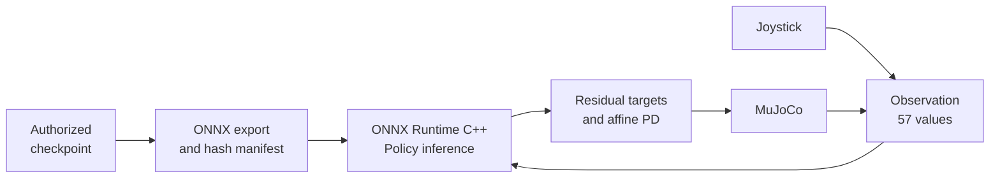

# Native C++ / ONNX deployment

This document describes the deployment half of the project: how the trained V24 actor leaves the
JAX training stack and runs in a native C++ control loop with joystick input. Code lives in
[`native/v24_runtime/`](../native/v24_runtime/README.md) and
[`src/biped_locomotion/deployment/`](../src/biped_locomotion/deployment/onnx_export.py).

> **Scope.** Deployment *software* is published. The trained ONNX weights, the checkpoint, the robot
> model and all robot-specific values are not. The runtime is a simulation/runtime integration; **no
> hardware deployment is claimed.**

## Pipeline

External model and bindings supply robot-specific data. The runtime event machine updates
phase, expected side and bilateral memory; no model, trained weights or filled bindings
are included in this release.

## 1. Export (`tools/export_onnx.py`)

The deterministic policy is `tanh(location)` of the actor head (docs/action_space.md). The exporter
extracts the running normalizer (mean/std) and the dense layers from a Brax PPO checkpoint, checks
the contract (`57 → … → 24`, float32, finite, `std > 0`, SiLU activation) and builds the graph

`(obs − mean)/std → [MatMul + Add + SiLU]* → MatMul + Add → Split(12, 12) → Tanh(first 12)`

with observation normalisation **embedded**, so the native side feeds raw observations. SiLU is
written as `x·sigmoid(x)` (opset 13), batch dimension is dynamic, and an `EXPORT_MANIFEST.json`
records the sha256 that the runtime verifies at start-up. The checkpoint must be supplied by an
authorized user; none is distributed. A NumPy reference forward pass
(`reference_forward`) and random-weight synthetic actors (`make_synthetic_actor`) make the export code
testable without any trained weights.

*Parity.* The exporter compares ONNX Runtime with the NumPy reference on random inputs
(`--parity-samples`). JAX and ONNX outputs agreed within the validation tolerance used during
private parity testing. This is author-reported: no numerical JAX-versus-ONNX test receipt is
retained in this release. Private parity cannot be reproduced without authorized artifacts;
public synthetic tests compare ONNX Runtime with the NumPy reference, not the private JAX actor.

## 2. Runtime contract

The public contract (`runtime_layout.h`) contains only: 12 joints / 12 actions, the 57-value
observation layout (docs/observation_space.md), `sim_dt = 0.002`, `ctrl_dt = 0.02`
(10 substeps), 1,500 settle steps, `e_y` scale 0.10 and the bilateral epsilon. Everything
robot-specific is a `RuntimeBindings` field loaded from JSON (joint/sensor/geom/body names, 12 action
scales, full initial `qpos`, `target_height`, `min_root_height`). Joint limits are read from the model
(`jnt_range`), actuator gains stay in the model. The Python counterpart is `ModelSpec`.

## 3. One control tick

1. `obs_t` (57 values) is ready from the previous tick.
2. Gamepad poll → forward-velocity command, low-pass filtered (`α = 0.2`).
3. `action_t = OnnxActor::Run(obs_t)` (CPU provider, 1 intra-op thread); non-finite inputs/outputs abort the run.
4. `target_t = clip(q_ref + action_scale · action_t, joint_lower, joint_upper)` where `q_ref` is the settled
   reset pose (`control_law.cpp`); written to the position actuators.
5. 10 `mj_step` calls (optional pulse force applied through `xfrc_applied`).
6. Event machine update **once per policy tick** from the stepped state: foot contact (distance ≤ 1 mm),
   vertical ground-reaction force, roll/pitch, gyro, root height. It maintains the V8/V9/V16/V24
   state (liftoff/touchdown qualification, expected-side transfer, forward placement, bilateral memory)
   and the V18 gait phase (`event_machine.cpp`; excludes all reward-only terms).
7. `obs_(t+1)` is built immediately (`obs_builder.cpp`): joint position − settled reference, joint
   velocity, up-vector, body-frame velocity, gyro, sin/cos phase, previous action, contacts,
   command-frame velocity (`vx·cos/sin` of the heading error), lateral error, heading, bilateral
   imbalance and pair validity. The arithmetic core `BuildObservationFromRaw` is separately unit-tested.
8. Telemetry row: commands, root pose, action statistics, clipping flag, contacts, inference latency,
   tick wall time, missed deadline (tick time > 20 ms), fall flag.

## 4. Joystick interface (`gamepad.h`)

| Input | Behaviour |
|---|---|
| Left stick, vertical axis (index 1) | Forward velocity command. Dead zone 0.08; stick forward → positive; piecewise-linear map of [−1, 1] to `[vx_min, vx_max] = [0.08, 0.12]` with neutral 0.10 (the trained range, `configs/v24_environment.json`) |
| Lateral velocity, yaw rate | **Always exactly 0**: the policy was trained with zero lateral/yaw commands |
| Buttons 0 / 1 / 2 / 3 / 4 | reset / pause / push pulse / camera cycle (follow, top, free) / log toggle |
| No controller | Neutral command; the loop never blocks |
| Hot-plug | SDL add/remove events handled each poll; removal falls back to neutral |

Command normalisation is therefore one scalar. The tick rate is 50 Hz. Only the no-controller path
has been exercised in tests; behaviour with physical hardware is unverified.

## 5. Failure and safety behaviour

* Startup: bindings validated against the model; optional sha256 check of the ONNX file against the manifest
  (mismatch → refuse to run). Missing or placeholder bindings → error before any simulation.
* Runtime: non-finite observation/action/state aborts; fall latch when root height < `min_root_height` or the
  up-vector z-component < 0.3; reset button re-settles and resets the event machine.
* Deadlines: every tick is timed; missed deadlines are counted in `summary.json`.
* This is simulation safety logic only. There is no actuator-limit watchdog, e-stop or hardware interface.

## 6. Software verification scope

The local results below describe the native-recovery checks. They validate software on
synthetic data, not trained-policy behavior on the restricted robot. The final public-readiness
pass runs only the available short contract subset and reports its actual results separately.

| Claim | Evidence | Where |
|---|---|---|
| Runtime compiles and 15 CTest entries pass on synthetic data | `ctest` | local; ONNX-free subset configured in CI |
| ONNX Runtime output equals a NumPy reference (synthetic weights) | `test_onnx_actor`, `test_onnx_export.py` | local |
| Observation layout and formulas, control law, hash refusal, bindings validation | unit tests | local; hosted CI status unverified |
| Closed loop executes end to end | synthetic smoke (25 ticks) | local |
| Hardware / physical joystick / on-screen viewer | not verified | — |

## 7. Differences from the private development version

The code was migrated, not rewritten. Changes: compile-time robot constants (joint names, scales,
initial pose, sensor/geom/body names, root-height target, gains) → runtime bindings; model loading by path
(`.mjb` or XML) instead of a fixed export directory; command-line interface; recorded-fixture replay apps and
model-bound tests removed and replaced by synthetic ones; private source references stripped from comments.
Not migrated: the model, ONNX weights, fixtures, run manifests, session notes.

Current non-stepping checks and publication boundaries: [final public-readiness pass](public_readiness.md).
